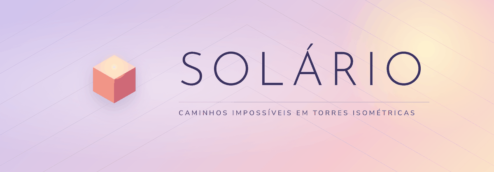
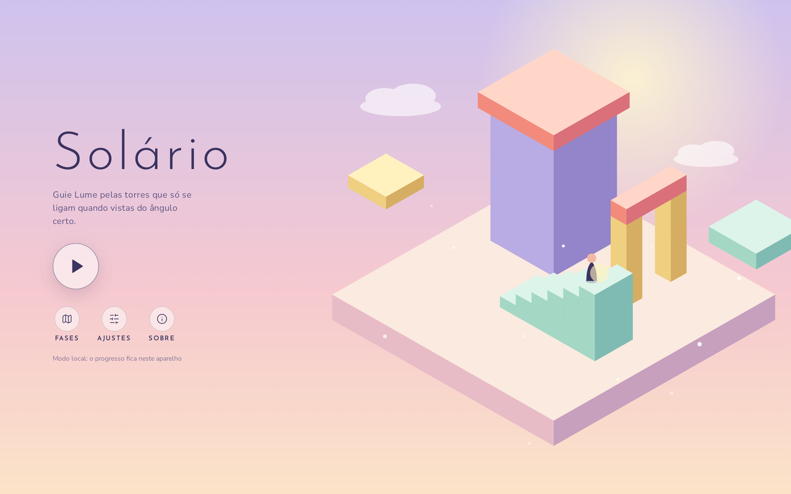
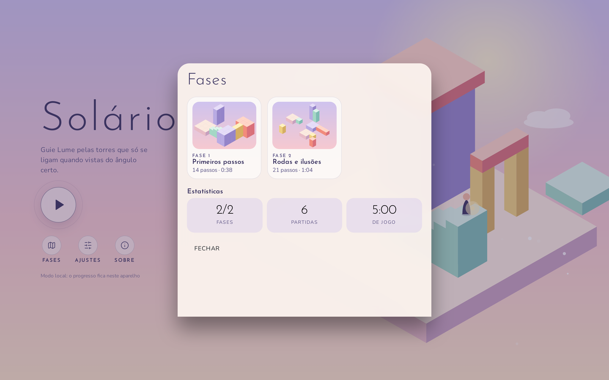
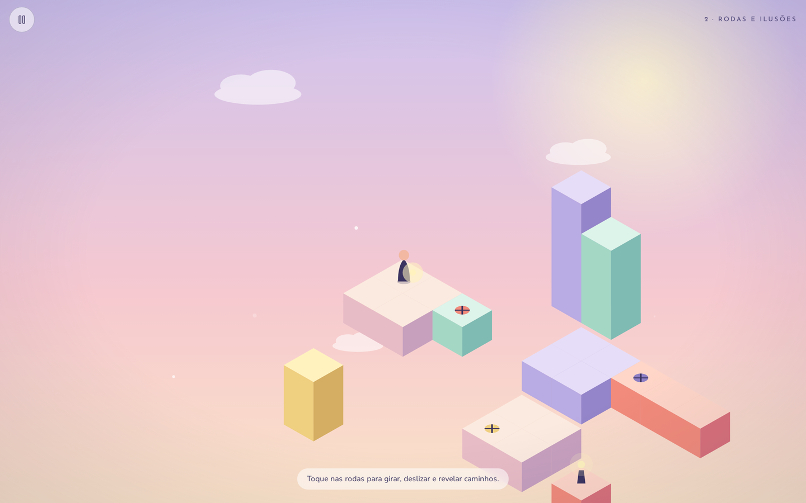
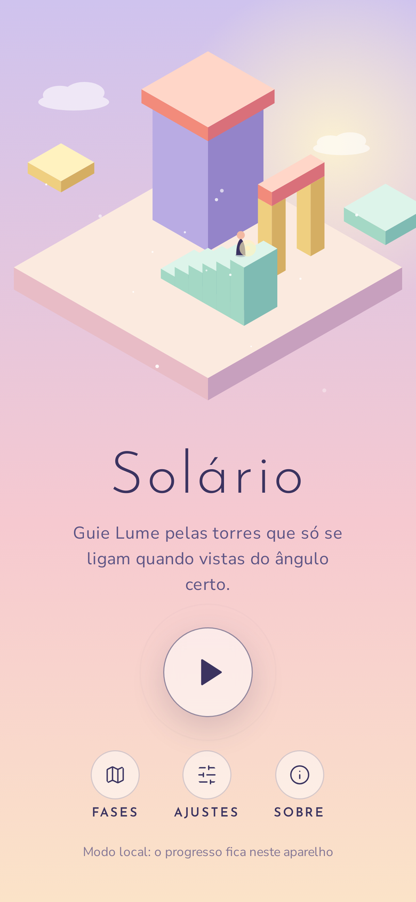
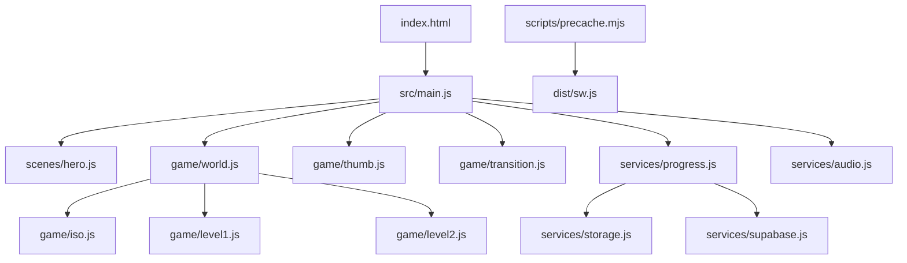

<div align="center">



**Um jogo de puzzle e exploração em perspectiva isométrica.**

[](https://solario-ten.vercel.app/) [](#status-do-projeto) [](#status-do-projeto) [](https://vite.dev) [](https://ionicframework.com) [](https://gsap.com) [](https://supabase.com) [](#pwa-e-offline)

</div>

> [!WARNING]
> **Projeto abandonado.**
> Este repositório foi descontinuado e não recebe mais manutenção. Não haverá novas fases, correções de bugs, atualizações de dependências ou respostas a issues e pull requests. O código permanece público apenas como registro do que foi construído e como referência técnica — se você pretende usá-lo como base, leia antes a seção [Limitações conhecidas](#limitações-conhecidas).

---

## Sobre o jogo

**Solário** é um jogo original de puzzle e exploração em perspectiva isométrica. Você guia **Lume**, uma viajante com lanterna, por torres, pontes e escadas que só se conectam quando vistas do ângulo certo. O objetivo de cada fase é atravessar a arquitetura e acender o farol no topo.

O jogo foi construído inteiramente com tecnologias web, sem engine 3D e sem arquivos de imagem para o cenário: o mundo é desenhado em **SVG** a partir de uma grade isométrica, as animações usam **GSAP** e todo o áudio é **sintetizado em tempo real** com a Web Audio API.

A versão jogável está publicada em **[solario-ten.vercel.app](https://solario-ten.vercel.app/)** e permanece no ar enquanto o deploy na Vercel existir — sem qualquer compromisso de disponibilidade, já que o projeto não é mais mantido.

<div align="center">
  
  <br><sub>Menu inicial — cena isométrica animada em SVG</sub>
</div>

<div align="center">
   
  <br><sub>Seleção de fases com miniaturas geradas dos dados · fase 2, com as rodas de mecanismo</sub>
</div>

<div align="center">
  
  <br><sub>Layout mobile — mesma cena, câmera aproximada</sub>
</div>

## Como se joga

| Ação | Toque / mouse | Teclado |
| --- | --- | --- |
| Andar | Toque no topo de um bloco alcançável | Setas ou `W` `A` `S` `D` |
| Ativar mecanismo | Toque na roda colorida sobre o bloco | Repetir o comando sobre o bloco |
| Pausar | Botão circular no topo | — |

Lume se move automaticamente pelo melhor caminho até o bloco escolhido. Dois blocos vizinhos se conectam quando a diferença de altura é de no máximo um degrau; algumas passagens, porém, só existem na projeção — o caminho "impossível" que dá nome à mecânica do jogo. Ao alcançar o farol, a lanterna se ergue, o farol acende e a fase é concluída com contagem de passos e tempo.

O progresso é salvo automaticamente no aparelho e, se o Supabase estiver configurado, sincronizado na nuvem. As fases são liberadas em sequência, e cada uma guarda recorde de passos, recorde de tempo, número de partidas e totais acumulados.

## Status do projeto

Este projeto está **abandonado**. Ele foi desenvolvido em cinco etapas e interrompido com duas fases jogáveis, quando o núcleo técnico já estava completo e estável.

| Área | Situação |
| --- | --- |
| Identidade visual, logo e menu inicial animado | Concluído |
| Motor isométrico em SVG (projeção, profundidade, câmera) | Concluído |
| Movimento por busca em largura e animação de Lume | Concluído |
| Fase 1 — *Primeiros passos* | Concluído |
| Fase 2 — *Rodas e ilusões* | Concluído |
| Mecanismos: deslizar, girar 90° e revelar passagem | Concluído |
| Pausa, conclusão, recordes, estatísticas e desbloqueio progressivo | Concluído |
| Progresso local e sincronização opcional com Supabase | Concluído |
| Áudio sintetizado (efeitos e pad ambiente) | Concluído |
| PWA, service worker e precache offline | Concluído |
| Fases 3 e seguintes | Não implementado |
| Testes automatizados, lint e CI | Não implementado |

## Como rodar

Requisitos: **Node.js 20.19+ ou 22.12+** (exigência do Vite 8) e npm.

```shell
npm install
npm run dev        # servidor de desenvolvimento
npm run build      # gera dist/ e injeta o precache no service worker
npm run preview    # serve o build de produção
```

> O service worker é registrado apenas em produção (`import.meta.env.PROD`). Para testar o comportamento offline, use `npm run build` seguido de `npm run preview` — no `npm run dev` ele fica desativado de propósito.

O build atual gera cerca de 2,1 MB em `dist/` (85 arquivos com hash, dos quais ~166 kB/57 kB gzip são o bundle principal; o restante são trechos do Ionic carregados sob demanda).

## Stack

| Tecnologia | Papel no projeto |
| --- | --- |
| [Vite](https://vite.dev) 8 | Servidor de desenvolvimento e build |
| JavaScript (ES Modules) | Sem framework de UI: DOM direto e módulos nativos |
| [Ionic Core](https://ionicframework.com) 8 | Web components para modais, toasts, range e toggle |
| [GSAP](https://gsap.com) 3 | Timeline, transições de cena e animações do mundo |
| SVG | Renderização do mundo isométrico e do ator |
| [Lucide](https://lucide.dev) + [Font Awesome](https://fontawesome.com) Free | Ícones da interface |
| Web Audio API | Efeitos sonoros e pad ambiente sintetizados |
| [Supabase](https://supabase.com) 2 (opcional) | Autenticação anônima e progresso na nuvem |
| [Vercel](https://vercel.com) | Deploy estático e cabeçalhos de cache/segurança |
| Service Worker + Web App Manifest | Instalação como PWA e funcionamento offline |

## Arquitetura

```
solario/
├── index.html                  Shell da aplicação, fontes e meta tags
├── src/
│   ├── main.js                 Menu, fluxo de jogo, pausa, conclusão e registro das fases
│   ├── scenes/hero.js          Cena isométrica animada da tela inicial
│   ├── game/
│   │   ├── iso.js              Projeção isométrica, paleta e utilitários de SVG
│   │   ├── world.js            Motor: grade, busca de caminho, mecanismos, câmera e ator
│   │   ├── level1.js           Dados da fase 1
│   │   ├── level2.js           Dados da fase 2 (mecanismos e ligações por perspectiva)
│   │   ├── thumb.js            Miniatura da fase desenhada a partir dos mesmos dados
│   │   └── transition.js       Cortina circular entre menu e jogo
│   ├── services/
│   │   ├── audio.js            Síntese de efeitos e pad ambiente
│   │   ├── progress.js         Progresso local, recordes e sincronização
│   │   ├── storage.js          Preferências do jogador (volume, movimento reduzido)
│   │   └── supabase.js         Cliente opcional, criado só se houver variáveis de ambiente
│   └── styles/main.css         Estilos, layout responsivo e movimento reduzido
├── public/                     Manifest, service worker e ícones
├── scripts/precache.mjs        Pós-build: lista os assets com hash dentro do sw.js
├── supabase/schema.sql         Tabelas, restrições e políticas de RLS
└── vercel.json                 Cache e cabeçalhos de segurança
```



**Projeção isométrica.** Toda a geometria do jogo vem de uma única função em `src/game/iso.js`: cada bloco é um cubo de grade convertido em três polígonos (topo, face esquerda, face direita) com cores fixas por paleta.

```js
export const W = 36, H = 20.5, Z = 36;
export const P = (x, y, z) => [(x - y) * W, (x + y) * H - z * Z];
```

**Profundidade e câmera.** Os blocos são ordenados por `x + y` e redesenhados a cada movimento de mecanismo; Lume é reinserida na ordem para ficar sempre à frente do bloco em que está. A câmera persegue o ator com interpolação suave (`0.08` por frame) e aproxima o zoom em telas estreitas.

**Movimento.** O caminho é resolvido por busca em largura sobre a grade de blocos andáveis, aceitando vizinhos com diferença de altura de até um degrau e as ligações declaradas em `level.links` — atalhos que existem apenas na projeção isométrica.

**Mecanismos.** Cada mecanismo é declarado na fase e reposiciona os blocos que controla:

| Tipo | Efeito |
| --- | --- |
| `slide` | Desloca os blocos em `offset` (x, y e altura), com Lume sendo carregada junto |
| `rotate` | Gira o conjunto 90° ao redor de um pivô |
| `door` | Revela ou esconde uma passagem, reconstruindo a grade de colisão |

## Criando uma fase

Cada fase é um objeto de dados puro — nenhuma lógica de renderização precisa ser alterada. O formato de cada bloco é `[x, y, altura, paleta, andável, gatilho, mecanismo]`, com altura em meios-blocos.

```js
// src/game/level3.js
export const level3 = {
  hint: 'Observe a sombra antes de atravessar.',
  start: [0, 4],
  goal: [9, 2],
  tiles: [
    [0, 4, 2, 'pedra'],            // bloco andável
    [1, 4, 3, 'menta'],            // um degrau acima: conecta
    [9, 2, 6, 'coral'],            // farol
    [2, 1, 8, 'lilas', 0],         // decoração: não andável
  ],
  mechs: [{ kind: 'rotate', color: '#8E7FC4', pivot: [5, 4], states: 2 }],
  links: [[[4, 4], [9, 2]]],       // ligação apenas na projeção
};
```

Depois, importe a fase e registre-a em `LEVELS` no `src/main.js`:

```js
import { level3 } from './game/level3.js';
const LEVELS = [
  { ...level1, name: 'Primeiros passos' },
  { ...level2, name: 'Rodas e ilusões' },
  { ...level3, name: 'Sombras' },
];
```

A miniatura da tela de fases é gerada automaticamente por `src/game/thumb.js`, então não é preciso criar imagem nenhuma.

## Supabase (opcional)

O jogo funciona por completo sem backend. Para sincronizar o progresso entre aparelhos:

1. Crie um projeto no Supabase e, em **Authentication → Providers**, ative **Anonymous sign-ins**.
2. Execute `supabase/schema.sql` no **SQL Editor** (cria as tabelas `level_progress` e `player_settings`, com RLS habilitado).
3. Copie `.env.example` para `.env` e preencha:

```shell
VITE_SUPABASE_URL=https://seu-projeto.supabase.co
VITE_SUPABASE_ANON_KEY=sua-chave-anon-publica
```

A chave anon é pública por design: a proteção vem das políticas de RLS, que restringem cada jogador às próprias linhas. Na inicialização, o app autentica anonimamente, mescla o progresso da nuvem com o local (mantendo o melhor de cada um) e envia as preferências de áudio e movimento reduzido.

Sem variáveis de ambiente — ou sem rede — o progresso fica em `localStorage` e o jogo segue normalmente, com o status "Modo local" no menu.

## PWA e offline

O `public/sw.js` é um service worker próprio, sem Workbox. Após o build, `scripts/precache.mjs` lê `dist/assets`, calcula um hash do conjunto e injeta a lista de arquivos e a versão do cache dentro do `sw.js`:

```js
const V = 'solario-b56e1161';
const ASSETS = ['/assets/index-....js', /* ... */];
```

Assim, cada build invalida o cache antigo automaticamente. Após a primeira visita online, o app inteiro abre offline; `vercel.json` garante `no-cache` para o `sw.js` e cache imutável de um ano para `/assets/*`.

## Deploy

O projeto é estático e foi pensado para a Vercel:

1. Importe o repositório na Vercel (framework **Vite**, build `npm run build`, saída `dist`).
2. Cadastre as variáveis `VITE_SUPABASE_URL` e `VITE_SUPABASE_ANON_KEY` — ou nenhuma, para rodar em modo local.
3. Publique. O `vercel.json` já define `X-Content-Type-Options`, `Referrer-Policy` e `Permissions-Policy`, além das regras de cache.

## Acessibilidade e desempenho

- Controles por teclado (setas e `WASD`) e áreas de toque amplas nos blocos.
- Rótulos ARIA nas ações principais, `aria-live` nas dicas de jogo e `:focus-visible` visível.
- Respeito a `prefers-reduced-motion` e opção explícita de "Reduzir animações" nos ajustes, que também desativa a poeira, as nuvens e a animação de entrada da câmera.
- Áudio suspenso quando a aba perde o foco, e volume ajustável de 0 a 100.
- Sem imagens de cenário e sem arquivos de áudio: o peso do projeto vem praticamente do runtime do Ionic, carregado sob demanda.

## Decisões técnicas

**SVG em vez de Canvas ou WebGL.** O mundo tem poucos polígonos e precisa de áreas de clique precisas por bloco, texto nítido e acessibilidade por DOM. O custo é o número de nós — aceitável nas duas fases atuais, mas limitante para cenários muito maiores.

**Sem engine nem framework de UI.** A lógica de jogo é JavaScript puro sobre módulos ES; o Ionic entra apenas como web components para modais e controles. Isso mantém o fluxo de dados explícito e o bundle pequeno.

**Áudio sintetizado.** Efeitos e pad ambiente são gerados por osciladores e envelopes de ganho, o que elimina arquivos, licenças de áudio e problemas de carregamento offline.

**Local-first.** O progresso é gravado no aparelho e a nuvem é um espelho opcional; nenhuma funcionalidade depende de rede ou de conta.

## Limitações conhecidas

- Apenas duas fases; não há editor, seleção de dificuldade nem modo contínuo.
- O `aria-label` do SVG do mundo ainda anuncia "Fase 1" em todas as fases.
- O texto da tela "Sobre" menciona "Etapa 1 de 5", referência ao plano de desenvolvimento original já concluído.
- Sem testes automatizados, lint, formatação ou pipeline de CI.
- Sem arquivo de licença, o que impede legalmente a reutilização do código sem autorização do autor.
- A sincronização com Supabase usa autenticação anônima: limpar os dados do navegador cria um novo jogador, sem forma de recuperar o progresso anterior.
- O service worker é registrado apenas no build de produção, então o modo offline não pode ser testado em `npm run dev`.

## Se quiser retomar

O projeto está parado, mas o núcleo é funcional e pequeno (~900 linhas em `src/`). Para continuar de onde parou:

1. `npm install` e `npm run dev` para confirmar que o build atual funciona na sua versão de Node.
2. Atualize as dependências com cuidado — Ionic 8 e Vite 8 são as que mais impactam o build.
3. Crie `src/game/level3.js` seguindo o formato acima e registre em `LEVELS`.
4. Antes de publicar, defina uma licença e configure as variáveis do Supabase, se quiser progresso na nuvem.

## Licença e créditos

Este repositório **não possui arquivo de licença**; portanto, o código está protegido por direitos autorais e não pode ser redistribuído ou reutilizado sem autorização do autor.

- Autor: **Junior Santos** ([@JS171555](https://github.com/JS171555))
- Tipografia: [Josefin Sans](https://fonts.google.com/specimen/Josefin+Sans) e [Nunito Sans](https://fonts.google.com/specimen/Nunito+Sans), sob SIL Open Font License
- Ícones: [Lucide](https://lucide.dev) (ISC) e [Font Awesome Free](https://fontawesome.com/license/free) (CC BY 4.0 / SIL OFL / MIT)
- Bibliotecas: Vite (MIT), Ionic (MIT), Supabase JS (MIT), Lucide (ISC) e GSAP, distribuído sob a licença própria da GreenSock

<div align="center"><sub>Solário · projeto encerrado · novembro de 2026</sub></div>
